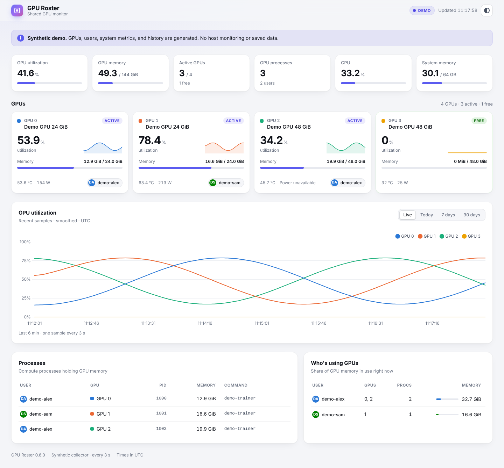
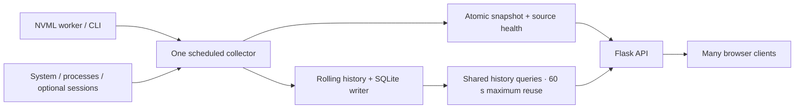

<div align="center">


# GPU Roster

**See which GPUs are free and who is using the rest on a shared NVIDIA host.**

[](https://github.com/drakishev/gpuroster/actions/workflows/ci.yml)


</div>

<picture>
  <source media="(prefers-color-scheme: dark)" srcset="docs/images/demo-dashboard-dark.png" />
  
</picture>

<sub>Screenshot from the built-in demo. It contains no real host or user data.</sub>

GPU Roster is a small, self-hosted dashboard for GPU utilization, memory, and
process ownership. It uses Flask, NVML (with an `nvidia-smi` fallback), psutil,
and SQLite. One scheduled collector feeds every viewer the same snapshot, so
many people can keep the page open without extra load on the GPUs.

## Highlights

- **Free at a glance.** Each GPU is marked ACTIVE, IDLE, FREE, or UNKNOWN, and
  the browser tab title shows how many are free, so you can watch from a
  background tab.
- **Who holds what.** Processes with owner, PID, and memory, plus each user's
  share of total GPU memory.
- **Live and historical charts.** A rolling live view plus today, 7-day, and
  30-day views from up to 31 days of SQLite history, with stable,
  color-blind-safe colors per device.
- **Light and dark themes** that follow your system, with a toggle that
  remembers your choice. The layout works on phones too.
- **Safe defaults.** Binds to loopback, supports HTTP Basic authentication, uses
  a strict content policy, and loads nothing from third parties at runtime.
  Command arguments and login sessions are hidden unless you enable them.
- **Honest data.** Partial, stale, and unavailable sources are labeled as such
  and never shown as zero.

## Quick start

### Try it without a GPU

With Docker, create a password and start the packaged demo:

```bash
python3 scripts/container_password.py
docker compose up --build -d demo
```

Open **http://127.0.0.1:18081** and sign in as **viewer** with that password.
See [Docker deployment](docs/docker.md) for NVIDIA GPU access, persistent
history, configuration, and validation.

Or with Python 3.10+ on Linux:

```bash
git clone https://github.com/drakishev/gpuroster.git
cd gpuroster
python3 -m venv venv
venv/bin/python -m pip install --require-hashes --only-binary=:all: -r requirements/build.lock -r requirements/runtime.lock
venv/bin/python -m pip install --no-deps --no-build-isolation .
venv/bin/gpuroster --demo
```

Demo mode shows four generated GPUs, example processes and users, synthetic
system metrics, and populated live, today, week, and month charts. It reads no
GPU tools, host processes, or login records. It never opens or writes
`GPUROSTER_DB_PATH`, and its history lives in memory and disappears on exit. A
persistent banner and API mode markers identify the data as synthetic.
`GPUROSTER_DEMO=1` also enables demo mode, and `GPUROSTER_SHOW_SESSIONS=1` adds
generated session panels. Authentication, loopback restrictions, and privacy
defaults still apply. See the
[demo and asset decision](docs/architecture/ADR-005-offline-assets-and-demo.md).

### Monitor a real host

You need an NVIDIA driver that provides NVML (`libnvidia-ml`) and permission
to inspect the relevant processes. The CLI fallback needs `nvidia-smi`.
Optional session history needs util-linux `last` with ISO timestamp support
and readable login records.

```bash
git clone https://github.com/drakishev/gpuroster.git
cd gpuroster
python3 -m venv venv
venv/bin/python -m pip install --require-hashes --only-binary=:all: -r requirements/build.lock -r requirements/runtime.lock
venv/bin/python -m pip install --no-deps --no-build-isolation .
bash start.sh
```

Open **http://127.0.0.1:18081**. The launcher binds to loopback by default.
Missing GPU tools show a visible partial-data status but do not stop the web
interface from opening.

After installation you can also run `gpuroster` from any directory in the
activated environment. `gpuroster --version` prints the installed version. The
wheel includes the templates, CSS, Chart.js, and dashboard scripts, so the
dashboard needs no external network access.

### Access a remote machine

Keep the application on loopback and use an SSH tunnel:

```bash
ssh -N -L 18081:127.0.0.1:18081 user@example.invalid
```

Replace the example destination with your own, then open the same local URL.
Other users on the server can reach its loopback interface, so configure
authentication on a shared host. For systemd, password files, persistent
state, TLS, and migration or rollback, see the
[deployment guide](docs/deployment.md) and the
[production-serving decision](docs/architecture/ADR-004-production-deployment.md).

The commands above use [tested dependency locks](requirements/README.md).
Normal pip resolution also works through the package metadata. CI produces
[verified build bundles](docs/releases.md) with a wheel, source archive, locks,
checksums, and build information after all checks pass.

## Configuration

Settings come from environment variables, read at startup. `.env` files are
not loaded automatically.

| Environment variable | Default | Purpose |
| --- | --- | --- |
| `GPUROSTER_DEMO` | `0` | Use synthetic sources and in-memory history; `--demo` also enables this mode |
| `GPUROSTER_HOST` | `127.0.0.1` | Listening address |
| `GPUROSTER_PORT` | `18081` | Listening port |
| `GPUROSTER_AUTH_USER` | unset | Basic-auth username; requires password |
| `GPUROSTER_AUTH_PASSWORD` | unset | Basic-auth password; requires username |
| `GPUROSTER_AUTH_PASSWORD_FILE` | unset | Read a password from a protected file; cannot be combined with `GPUROSTER_AUTH_PASSWORD` |
| `GPUROSTER_SHOW_COMMANDS` | `0` | Include truncated command arguments |
| `GPUROSTER_SHOW_SESSIONS` | `0` | Enable SSH connections and login/session APIs and panels |
| `GPUROSTER_COMMAND_TIMEOUT` | `3` | Timeout in seconds for each command or NVML worker response; greater than 0, at most 30 |
| `GPUROSTER_GPU_BACKEND` | `auto` | Prefer the NVML worker; fall back to CLI if initialization is unavailable. Explicit choices: `nvml`, `smi` |
| `GPUROSTER_COLLECT_INTERVAL` | `3` | Shared collection interval in seconds, 0.1–60; clients do not change it |
| `GPUROSTER_SESSION_INTERVAL` | `60` | Optional session/SSH evidence refresh in seconds, 1–3600 |
| `GPUROSTER_TIMEZONE` | `UTC` | IANA timezone that defines “today” and the dashboard's displayed times; API timestamps stay UTC |
| `GPUROSTER_DB_PATH` | See below | SQLite history file; the launcher creates the parent directory |

- Boolean options accept `0`, `1`, `false`, or `true`.
- `bash start.sh` and `python app.py` keep the checkout's `gpu_stats.db`. The
  installed `gpuroster` command and `python -m gpuroster` default to
  `$XDG_STATE_HOME/gpuroster/history.db` (or
  `~/.local/state/gpuroster/history.db`). Set `GPUROSTER_DB_PATH` explicitly
  when migrating an existing installation; the launcher never copies an old
  database automatically.
- If neither password option is set, the launcher also reads
  `dashboard-password` from systemd's `CREDENTIALS_DIRECTORY` when provided. A
  missing or empty configured credential fails startup.
- Keep databases and credentials outside Git.

## Access and privacy

Optional HTTP Basic authentication protects the page, static assets, and every
API. Set credentials through your service's secret configuration, or read them
interactively so they stay out of shell history:

```bash
read -r -p 'Dashboard username: ' GPUROSTER_AUTH_USER
read -r -s -p 'Dashboard password: ' GPUROSTER_AUTH_PASSWORD
printf '\n'
export GPUROSTER_AUTH_USER GPUROSTER_AUTH_PASSWORD
bash start.sh
```

Basic authentication needs an encrypted transport, such as an SSH tunnel or a
TLS-terminating reverse proxy. The application does not provide TLS or user
account management. Binding to a non-loopback address requires both
credentials, and forwarded identity headers are never trusted. See the
[access decision](docs/architecture/ADR-001-access-and-collection-safety.md).

Process owners, PIDs, and executable names are visible to authorized viewers.
Command arguments and login/session details are off by default. Turning them
on may show sensitive command arguments or client addresses to every viewer.

## How it works



The collector runs in one thread inside the web process. NVML calls run in one
persistent child process, so a stalled driver call can time out and the
worker can restart. CLI collection remains available. API requests copy the
published snapshot; they never poll hardware. History requests share SQLite
results per range for less than 60 seconds from query start, and a successful
write invalidates earlier results. Responses report query time and age
separately from current writer health. See
[ADR-006](docs/architecture/ADR-006-shared-history-queries.md).

Collection runs on a monotonic schedule and skips missed intervals instead of
piling up work. Each snapshot carries a sequence number, a UTC collection
timestamp, the backend name, and source ages. An HTTP response does not make an
old measurement fresh. The first CPU reading is unknown until the collector has
a baseline.

The code lives in the `gpuroster` package:

- `server.py` owns HTTP and collector startup and shutdown.
- `app.py` serves HTTP and enforces access.
- `monitoring/models.py` defines measurements.
- `collectors.py` and `nvml.py` read sources.
- `service.py` owns scheduling, caching, and lifecycle.
- `sessions.py` accounts for login intervals.
- `history.py` owns rolling data and SQLite.

The dashboard (`templates/index.html`, `static/dashboard.js`) updates GPU cards
in place, and themes come from CSS design tokens. See
[ADR-002](docs/architecture/ADR-002-shared-collection.md),
[ADR-003](docs/architecture/ADR-003-time-identity-and-accounting.md), and
[ADR-009](docs/architecture/ADR-009-dashboard-experience.md).

### API

`GET /api/stats` returns the current snapshot (`schema_version: 2`), and
`GET /api/gpu_history?range=today|week|month` returns bucketed history. Session
routes return `403` unless enabled. Before the first snapshot, `/api/stats`
returns `503 collector_not_ready`. Starting the collector is explicit:
importing the WSGI factory (`gpuroster.app:create_app`) does not start
collection or take database ownership. See the
[snapshot contract](docs/architecture/snapshot-v2.md) and the notes on
[upgrading from earlier versions](docs/upgrading.md).

Connected time is the union of a user's session intervals, clipped to each
window, so simultaneous terminals count once. “Today” uses the configured
timezone, including DST. Week and month mean the last 7 and 30 elapsed days.
Non-interactive SSH contributes only currently visible evidence and is not
stored as an authoritative session ledger.

## Development

Ordinary tests need no GPU, login records, credentials, or production
database. Browser tests use synthetic metrics and also exercise the real
packaged assets with external requests blocked.

```bash
venv/bin/python -m pip install --require-hashes --only-binary=:all: -r requirements/build.lock -r requirements/dev.lock
venv/bin/python -m playwright install --with-deps chromium
venv/bin/python -m unittest discover -s tests -v
venv/bin/python -m unittest discover -s tests/browser -v
venv/bin/python -m unittest discover -s tests/packaging -v
venv/bin/python scripts/lock_dependencies.py --check
venv/bin/ruff check .
venv/bin/ruff format --check .
node --check gpuroster/static/dashboard.js
bash -n start.sh
```

The backend tests alone need only the runtime dependencies
(`venv/bin/python -m unittest discover -s tests -v`). Frontend assets are
served locally under a restrictive content policy, and Node is needed only to
rebuild them; see the [asset workflow](frontend/README.md).

[CI](.github/workflows/ci.yml) runs locked installs on Python 3.10, 3.12, and
3.14, and separately tests the latest compatible runtime dependencies. It also
runs Chromium regressions, checks formatting, lint, and asset/lock drift, tests
installed packages and containers, audits runtime dependencies, and compares
two independent release builds before uploading the tested bundle. Read the
[contribution guidelines](CONTRIBUTING.md) before opening a pull request.

## Documentation

| Topic | Where |
| --- | --- |
| Docker and Compose | [docs/docker.md](docs/docker.md) |
| systemd, TLS, and migration | [docs/deployment.md](docs/deployment.md) |
| Release bundles | [docs/releases.md](docs/releases.md) |
| Upgrading from earlier versions | [docs/upgrading.md](docs/upgrading.md) |
| Architecture decisions | [docs/architecture/](docs/architecture/) |
| Benchmarks and measurements | [docs/benchmarks.md](docs/benchmarks.md) |
| Hardware validation | [docs/validation/hardware.md](docs/validation/hardware.md) |

## Limits and next work

- An optional [read-only hardware validation command](docs/validation/hardware.md)
  checks NVML/CLI agreement, native worker memory, and worker recovery on a
  target host. Ordinary CI stays hardware-independent. The
  [Phase 7 results](docs/validation/phase-seven.md) record a passing 15-minute
  eight-GPU observation and bounded synthetic identity retention, with explicit
  limits on driver and permission coverage.
- The collector reports physical GPUs. Per-MIG-instance monitoring is not
  implemented, and FREE is a heuristic, not a reservation.
- The launcher uses Waitress with four HTTP threads, one collector thread, and a
  child NVML worker. A local advisory lock rejects a second launcher on the same
  database. SIGINT and SIGTERM stop the HTTP loop and collector; in-flight
  responses may be cut off during shutdown. Run one instance on a local
  filesystem. The cache is per process, so multi-worker web deployment is not
  supported yet.
- Benchmarks cover one host and synthetic clients; they do not certify broad
  NVIDIA driver or MIG compatibility. Slow OS process inspection can still delay
  a collection cycle, while clients keep receiving cached data with its age and
  status. Cold history queries still occupy HTTP threads, though shared results
  avoid duplicate aggregation. Larger retention, downsampling, and an
  independent collector service remain future work.
- Connected-time estimates handle overlap and window boundaries, but login logs
  may be rotated, truncated, incomplete, or unreadable. SSH process visibility
  depends on OS permissions. These estimates are not billing records or GPU
  usage time.
- Python locks cover deployment and build dependencies. Operating-system,
  browser-system, and NVIDIA driver dependencies remain external. Demo data is
  illustrative and cannot validate driver support or target-host permissions.
